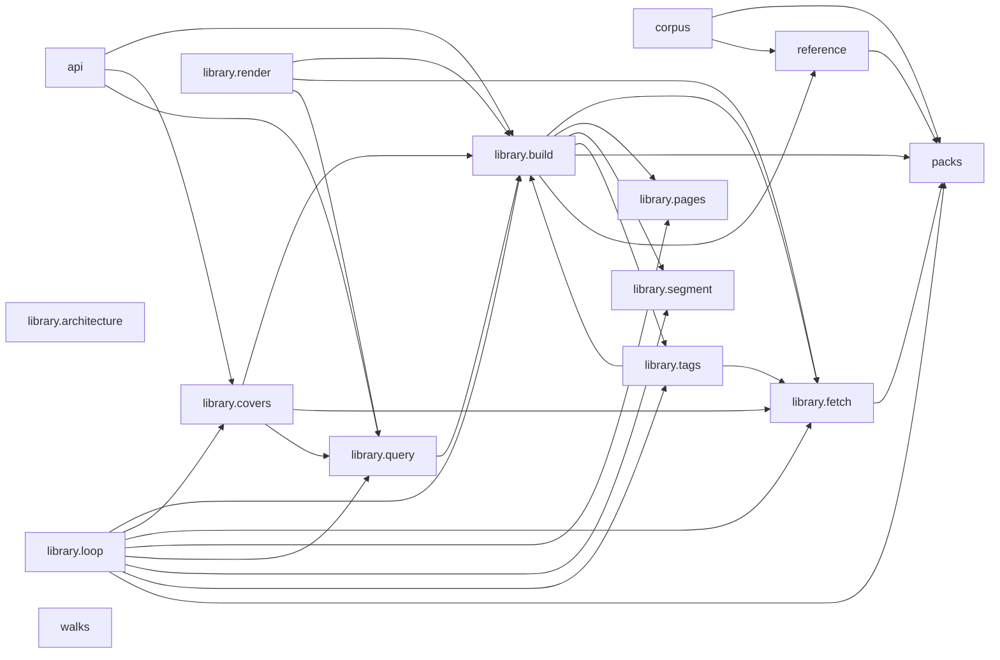
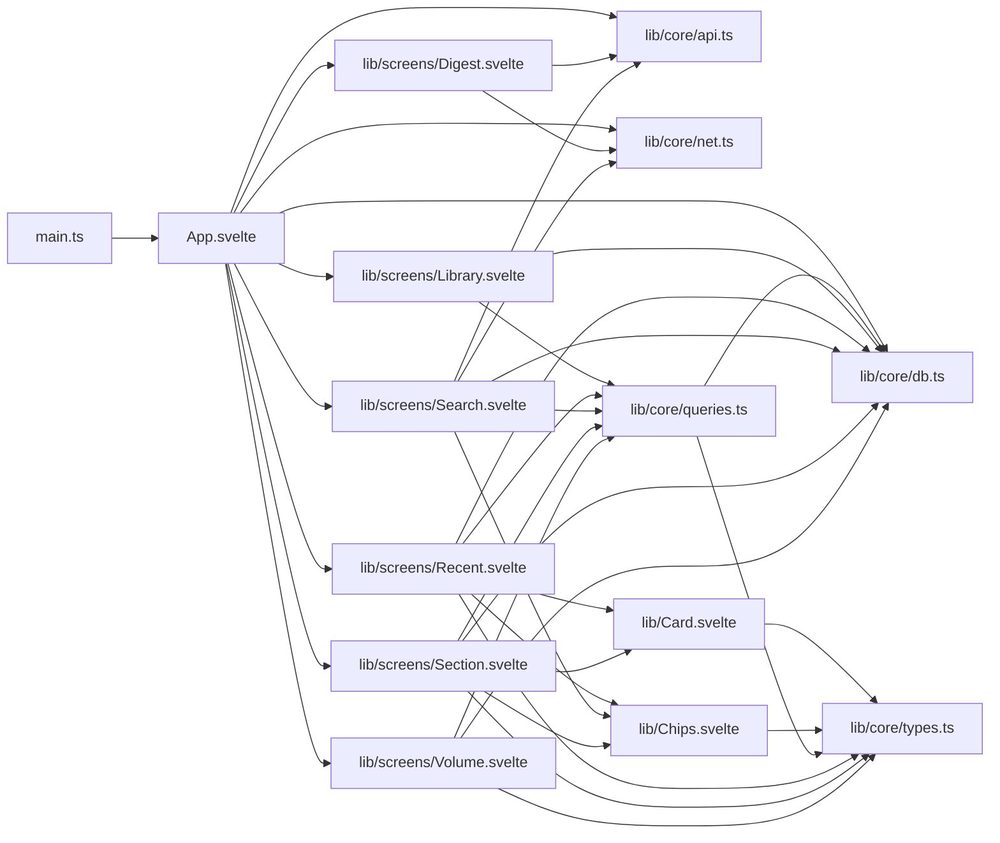

# Architecture, drawn from the code

Generated by `lifekit/library/architecture.py` from the imports in `lifekit/` and `web/src/`,
the routes in `lifekit/api.py`, and the tables in `packs/library.sqlite`. Regenerate after any
structural change; do not edit by hand.

## Python: the pipeline, the API, and the loop



## Web app: screens over the shared core



## API routes (lifekit/api.py)

- `GET /api/health`
- `GET /api/search`
- `POST /api/answer`
- `POST /api/questions`
- `POST /api/sync`
- `GET /api/digest`
- `GET /api/library.sqlite`

## Tables (packs/library.sqlite)

- `cover`
- `digest`
- `page`
- `passage`
- `passage_fts`
- `provenance`
- `question`
- `rag_test`
- `shelf`
- `shelf_volume`
- `volume`
- `volume_tag`

## Files on disk

```
packs/
  library.sqlite            every table above
  shelves/<shelf>/volumes.tsv   curated list; learned.tsv   what the loop pulled
  volumes/<id>/source.*, source.meta.json, cover.md, tags.json
web/public/library.sqlite    the copy the browser loads; thumbs/, fonts/
docs/progress/               screenshots and the thumbnails' first render
```

